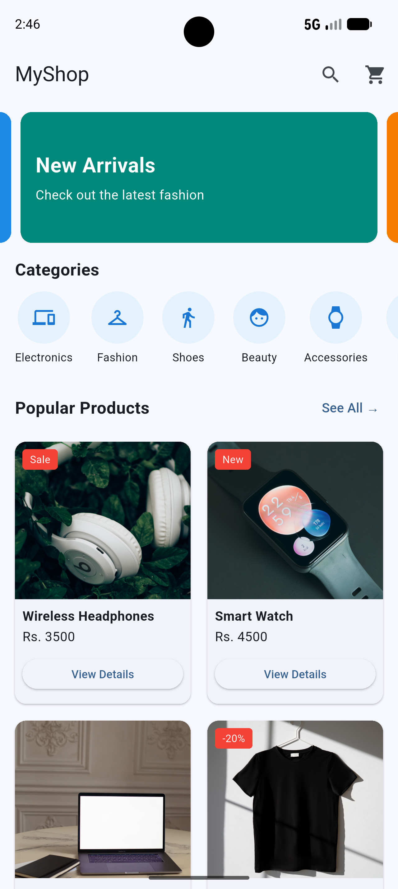
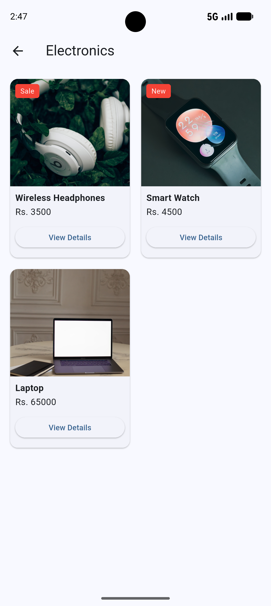
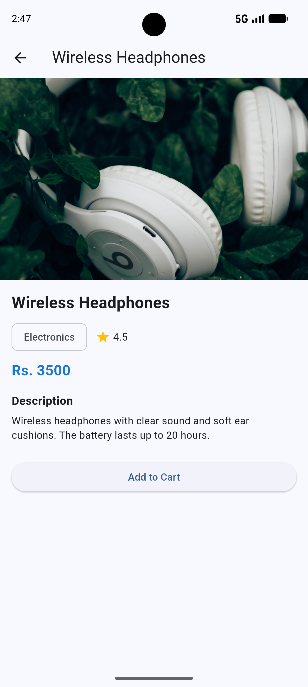

# E-commerce
# MyShop - Mini E-Commerce App

**Name:** Luna Twayana
**Course:** Mobile Application Development - Flutter

## Description
MyShop is a simple shopping app made with Flutter. It shows products in
different categories. The user can open a category page and a product
details page. The app uses static (local) data, so there is no backend,
login or database.

## Features
- Home page with AppBar, banner carousel, horizontal category list and popular products
- Reusable ProductCard widget made with Card, Container and Stack
- Category page that shows products in a GridView
- Product details page with image, name, price, rating, category and description
- Add to Cart button that shows a SnackBar message
- Navigation between screens using Navigator.push and passing data

## Screenshots

### Home Page

### Category Page

### Product Details Page

## Packages Used
- **carousel_slider**: used to make the sliding banners on the home page

## How to Run
1. Clone this repository
2. Open the project in Android Studio
3. Run `flutter pub get`
4. Start an emulator or connect a phone
5. Run `flutter run`
